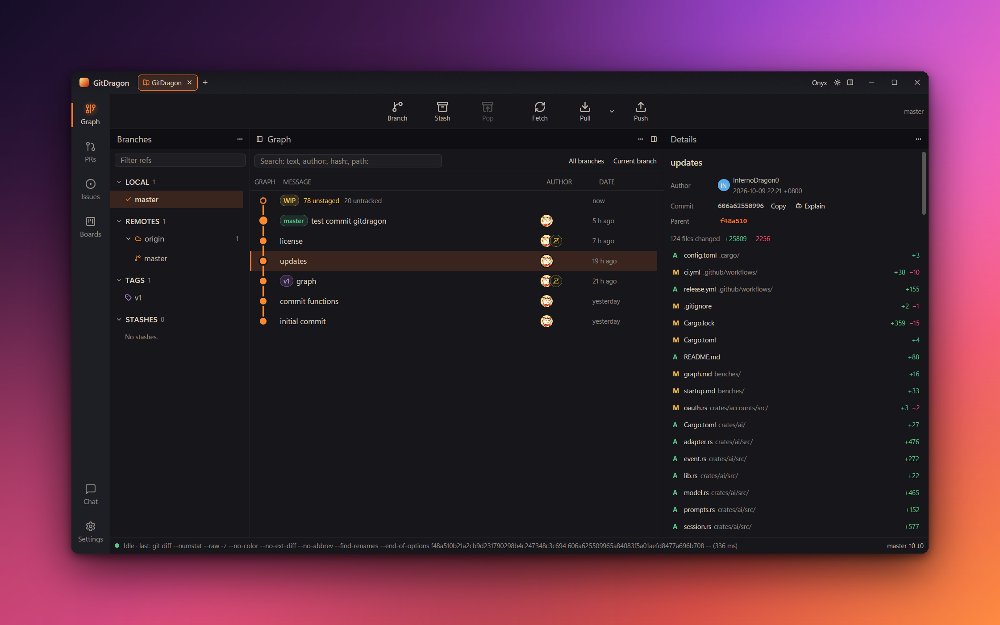
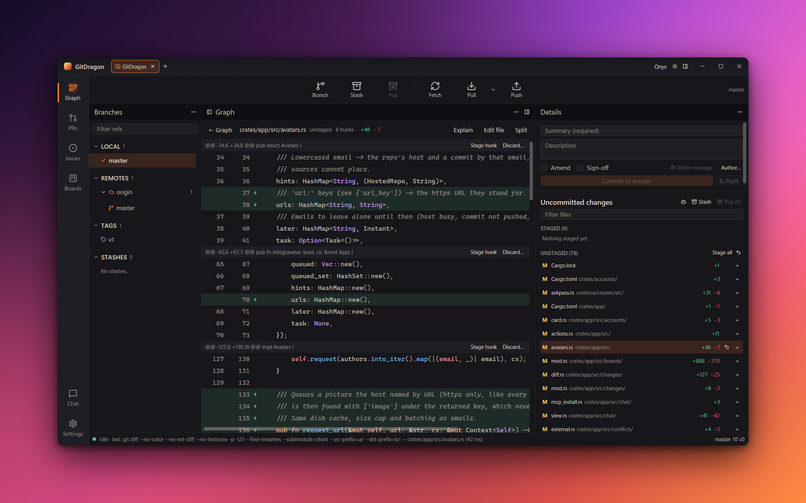

# GitDragon

A fast, native Git client for the desktop, written in Rust on [GPUI](https://www.gpui.rs/) (the UI framework behind Zed).
It drives your installed `git` instead of linking a Git library, so it behaves exactly like the command line you already trust.

> Status: pre-release (0.1.0). Unsigned builds only; expect rough edges.

<!-- SCREENSHOTS: add after the first tagged build.




-->

## Features

- **Commit graph** that stays smooth on huge repositories (tested on the Linux kernel, 1.4M commits), with a background commit-graph file for fast re-opens.
- **Changes view**: staged / unstaged / untracked sections, hunk and line staging, diffs, an inline file editor, commit box, amend, undo for the last operations.
- **Branches, tags, remotes, stashes** in a sidebar; WIP and stash rows in the graph; fetch / pull / push; rebase and merge with a conflict resolver.
- **Git LFS** awareness (pointer files, lock status) when `git-lfs` is installed.
- **Hosts**: GitHub, GitLab and Azure DevOps accounts, pull / merge requests, issues, and boards, via OAuth or tokens kept in the OS keychain.
- **AI chat (optional)**: talk to Claude Code from inside the app through the Agent Client Protocol.
- Command palette, keyboard-first navigation, light and dark skins (Aurora, Onyx), zoom.
- **No telemetry.** See [Privacy](#privacy).

## Requirements

| | |
|---|---|
| OS | Windows 10 or later (x64), macOS (Apple Silicon build), Linux x64 (X11 or Wayland) |
| GPU | Windows: DirectX 11 (Direct3D 11.1 device); macOS: Metal; Linux: Vulkan |
| Git | **2.35 or newer** on `PATH` (needed for `status --porcelain=v2 --show-stash`). Checked at startup |
| Optional | [Git LFS](https://git-lfs.com/) for LFS repositories |
| Optional | Node.js and the [`claude-code-acp`](https://www.npmjs.com/package/@zed-industries/claude-code-acp) adapter for the chat panel |

The Windows build links the C runtime statically, so no Visual C++ Redistributable is needed.

## Install

Release downloads will be published on the GitHub releases page once the first version is tagged:

- Windows: `GitDragon-<version>-windows-x64-setup.exe` (per-user installer) or the portable `.zip`
- macOS: `.dmg`
- Linux: `.AppImage`, `.deb`, or `.tar.gz`

Verify downloads against `SHA256SUMS` from the same release. Builds are currently **unsigned**: Windows SmartScreen and macOS Gatekeeper will warn on first launch.

## Build from source

Needs the Rust toolchain pinned in `rust-toolchain.toml` (rustup picks it up automatically) and a C toolchain for your platform
(MSVC Build Tools on Windows, Xcode command line tools on macOS).

```sh
cargo run --release -p gitdragon        # run
cargo build --release --locked -p gitdragon   # binary at target/release/gitdragon(.exe)
cargo test --workspace                  # tests
```

Linux also needs development packages for GPUI:

```sh
sudo apt-get install pkg-config libxkbcommon-dev libxkbcommon-x11-dev libwayland-dev \
  libx11-xcb-dev libxcb1-dev libvulkan-dev libfontconfig-dev libfreetype-dev libasound2-dev libssl-dev
```

Packaging (installers, checksums, signing hooks) is described in [docs/release.md](docs/release.md).

## Performance

Budgets: cold start under 300 ms, repository open under 500 ms, commit graph at 60 fps on 1M commits.
Measurements and how to reproduce them are in [benches/](benches/).

## Privacy

GitDragon sends nothing anywhere on its own: no telemetry, no analytics, no crash upload. Network traffic is limited to what you ask for:
`git` talking to your remotes, the Git host APIs for accounts you signed in to, optional Gravatar avatars (off by default),
and the chat adapter if you enable it. Tokens are stored in the OS keychain and redacted from logs and crash output.

## Security

Dependencies are checked with `cargo deny` (licences, advisories, sources) and `cargo audit` in CI; see `deny.toml`.
Please report vulnerabilities privately through GitHub security advisories rather than public issues.

## License

Licensed under either of [Apache License, Version 2.0](LICENSE-APACHE) or [MIT license](LICENSE-MIT) at your option.

Unless you explicitly state otherwise, any contribution intentionally submitted for inclusion in GitDragon by you,
as defined in the Apache-2.0 license, shall be dual licensed as above, without any additional terms or conditions.

All dependencies are permissively licensed (MIT / Apache-2.0 / ISC / BSD and similar), enforced by `cargo deny`;
a few MPL-2.0 crates are allowed by explicit exception only. Git itself is spawned as a separate process, never linked.
